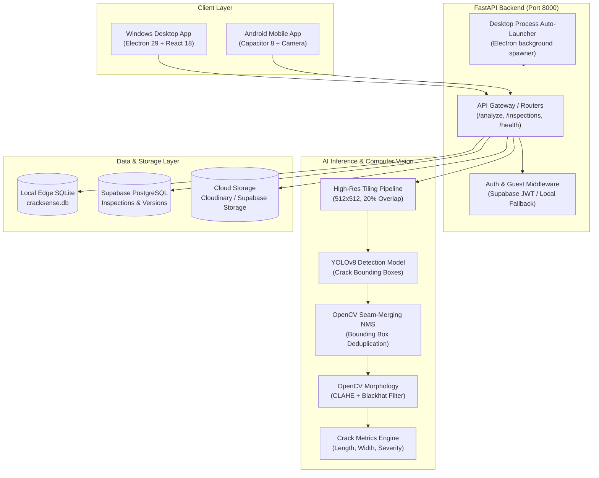
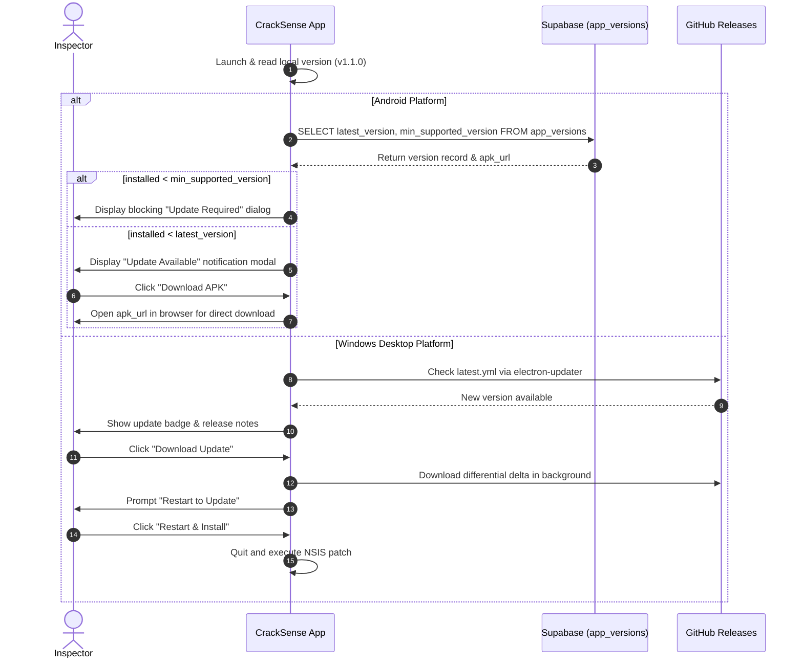

# CrackSense AI – Concrete Crack Detection System

[](https://github.com/Omkarmahanandia36/CrackSense-/releases)
[](https://github.com/Omkarmahanandia36/CrackSense-)
[](https://aws.amazon.com)
[](https://fastapi.tiangolo.com)
[](https://react.dev)
[](https://ultralytics.com)
[](https://supabase.com)

An AI-powered concrete crack detection system using deep learning and computer vision to identify, localise, and visualise cracks in concrete surfaces. 

CrackSense AI simplifies concrete surface inspection through automated image analysis. Users can upload concrete images, analyse them using trained AI models hosted 24/7 on AWS Lambda, visualise detected cracks, and maintain synchronized inspection records across Windows Desktop and Android Mobile.

---

## Table of Contents

- [Overview](#overview)
- [Key Features](#key-features)
- [System Architecture](#system-architecture)
- [AI Engine & Computer Vision Pipeline](#ai-engine--computer-vision-pipeline)
- [Technology Stack](#technology-stack)
- [Repository Structure](#repository-structure)
- [Getting Started](#getting-started)
  - [Prerequisites](#prerequisites)
  - [1. Backend Setup](#1-backend-setup)
  - [2. Frontend & Desktop Setup](#2-frontend--desktop-setup)
  - [3. Android Mobile Setup](#3-android-mobile-setup)
  - [4. Environment Configuration](#4-environment-configuration)
- [Running the Applications](#running-the-applications)
  - [One-Click Windows Launchers](#one-click-windows-launchers)
  - [Manual Execution](#manual-execution)
- [Packaging & Releases](#packaging--releases)
- [In-App Update System](#in-app-update-system)
- [Evaluation & Benchmark Metrics](#evaluation--benchmark-metrics)
- [Testing & Quality Assurance](#testing--quality-assurance)
- [Troubleshooting](#troubleshooting)
- [License](#license)

---

## Overview

Concrete cracks develop naturally across buildings, bridges, roadways, tunnels, dams, floors, and retaining walls due to tensile stress, thermal expansion, shrinkage, settlement, or environmental degradation. Timely detection and regular structural health monitoring prevent catastrophic structural failure and minimize repair expenditures.

Traditional manual inspection requires physical scaffolding, manual measurement, and subjective visual judgment—making it hazardous, labor-intensive, and prone to human inconsistency.

**CrackSense AI** automates this workflow with an end-to-end multi-platform application:
1. **Ingest:** Inspect via drag-and-drop file upload, direct camera snap on mobile, or batch imports.
2. **Detect & Localize:** Execute tiled high-resolution YOLOv8 inference with OpenCV Non-Maximum Suppression (NMS) to detect hairline and structural cracks without downsampling distortion.
3. **Segment & Quantify:** Compute pixel-precise morphological crack masks using adaptive CLAHE and Blackhat transforms, providing quantitative metrics (estimated length, max/mean width, severity index).
4. **Inspect & Interact:** View results in a responsive glassmorphic multi-mode viewer (`Original`, `Boxes`, `Mask`, `Both`) with real-time zoom/pan.
5. **Persist & Sync:** Maintain inspection records locally on SQLite with automatic background synchronization to Supabase PostgreSQL and secure cloud imagery storage.
6. **Report:** Generate professional structural inspection PDF reports with embedded metrics and visual comparisons in a single click.

---

## Key Features

- **High-Resolution Tiling YOLOv8 Detection:** Splits large ultra-high-resolution photographs into 512×512 patches with 20% overlap, running local YOLOv8 inference and seam-merging bounding boxes via OpenCV NMS.
- **Deep ResNet-18 Classification:** Binary surface verification trained on 40,000 concrete image patches achieving 99.8% validation accuracy.
- **Morphological Crack Masking:** CLAHE contrast normalization followed by Blackhat morphological filtering generates transparent alpha masks with 60% amber/red crack highlighting.
- **Crack Metric Quantification:** Morphological skeletonization extracts estimated crack length in pixels, maximum crack width, mean crack width, and assigns a structural severity grade (`None`, `Minor`, `Moderate`, `Severe`).
- **Interactive Multi-Mode Inspection Viewer:** Smooth scroll zoom, drag-to-pan, 1-click fit-to-view, and segmented switching across `Original`, `Boxes`, `Mask`, and `Both`.
- **Cross-Platform Native Builds:**
  - **Windows Desktop:** Electron 29 NSIS installer and portable executable with background Python AI auto-launcher (launches the backend silently when `.exe` starts).
  - **Android Mobile:** Capacitor 8 native Android application with hardware camera integration (`@capacitor/camera`) and configurable LAN backend connectivity.
- **In-App Auto-Update System (v1.1.0):**
  - **Desktop:** Integrated `electron-updater` checking GitHub Releases (`latest.yml`) with user-prompted background downloads and 1-click restart-to-install.
  - **Android:** Supabase-backed version checking (`app_versions` table) with semver comparison, prompt modal, and direct APK download link.
- **Dual-Database Architecture:**
  - **Local Edge:** Offline-first SQLite database (SQLAlchemy async) for zero-latency local persistence.
  - **Cloud Sync:** Supabase PostgreSQL for multi-inspector cloud synchronization, user authentication, and Cloudinary/Supabase media hosting.
- **Automated PDF Inspection Reports:** Standardized engineering inspection reports generated using ReportLab, complete with summary tables, detected bounding boxes, severity analysis, and inspector credentials.

---

## System Architecture



---

## AI Engine & Computer Vision Pipeline

CrackSense AI processes inspection images through an optimized pipeline:

```
[Raw Concrete Photograph]
         │
         ▼
[EXIF Transposition & Normalization]
         │
         ├───► [Tiled YOLOv8 Inference (512×512, 20% Overlap)]
         │             │
         │             ▼
         │      [OpenCV Seam-Merging NMS] ──► [Global Crack Bounding Boxes]
         │
         └───► [CLAHE Contrast Normalization]
                       │
                       ▼
               [Blackhat Morphological Filter]
                       │
                       ▼
               [Adaptive Thresholding & Skeletonization]
                       │
                       ├──► [Transparent RGBA Mask (Amber/Red Accent)]
                       └──► [Metrics: Estimated Length, Max/Mean Width, Severity]
```

### 1. High-Resolution Overlapping Tiling
To detect fine hairline fractures without downsampling blur, high-resolution photographs are partitioned into $512 \times 512$ pixel patches with a $20\%$ spatial stride overlap.

### 2. Seam-Merging Non-Maximum Suppression (NMS)
Crack bounding boxes predicted across adjacent tiles are translated back into global image coordinates and clustered using an intersection-over-union (IoU) threshold of $0.45$, merging split cracks into coherent detection boxes.

### 3. Morphological Crack Mask Extraction
- **CLAHE (Contrast Limited Adaptive Histogram Equalization):** Amplifies subtle dark fissures against varying concrete textures.
- **Blackhat Transform:** Isolates thin dark features narrower than the structuring element kernel.
- **Morphological Skeletonization:** Traces the medial topological axis of detected cracks to measure total pixel length and calculate local cross-sectional widths.

---

## Technology Stack

| Layer | Component | Technologies |
|---|---|---|
| **Desktop Client** | Desktop Container | Electron 29, `electron-builder`, `electron-updater` |
| **Mobile Client** | Android Runtime | Capacitor 8, Android SDK 34+, `@capacitor/camera`, `@capacitor/app` |
| **Frontend UI** | Interface & Styling | React 18, TypeScript, Vite 5, TailwindCSS, Lucide Icons |
| **Design Language** | Glassmorphism | Custom CSS Design Tokens (`#06141B`, `#11212D`, `#253745`, `#4A5C6A`) |
| **Backend API** | REST AI Engine | Python 3.11, FastAPI, Uvicorn, Pydantic v2 |
| **Computer Vision** | Image Processing | OpenCV 4.10, Pillow, NumPy |
| **Deep Learning** | Models | Ultralytics YOLOv8 (Detection), PyTorch ResNet-18 (Classification) |
| **Cloud AI Hosting** | 24/7 Managed Serverless | AWS Lambda Container (ap-southeast-2), AWS Lambda Web Adapter, ECR, CodeBuild |
| **Local Database** | Edge Persistence | SQLite (SQLAlchemy 2.0 Async, aiosqlite, Alembic) |
| **Cloud Infrastructure** | Cloud Services | Supabase (PostgreSQL, GoTrue Auth, Storage), Cloudinary SDK |
| **Report Generation** | Structural PDFs | ReportLab |

---

## Repository Structure

```text
CrackSense/
├── CrackSense-Desktop.bat          # One-click Windows launcher (FastAPI + Electron)
├── CrackSense-Mobile.bat           # One-click Mobile build & sync launcher
├── README.md                       # Comprehensive project documentation
├── RELEASING.md                    # Multi-platform release runbook
├── alembic.ini                     # Database migration configuration
├── docker-compose.yml              # Container orchestration
│
├── ai/                             # Machine Learning & Computer Vision
│   ├── classification/             # ResNet-18 training, evaluation, & inference
│   ├── detection/                  # YOLOv8 training, tiling, dataset merging, & NMS
│   ├── evaluation/                 # Metrics calculation (mAP, F1, precision, recall)
│   ├── export/                     # ONNX export, latency benchmarks, parity tests
│   └── preprocessing/              # CLAHE transforms, image split, perceptual hashing
│
├── backend/                        # FastAPI REST AI Application
│   ├── app/
│   │   ├── api/endpoints/          # /analyze, /inspections, /health, /auth, /models
│   │   ├── core/                   # config.py, database.py, security.py
│   │   ├── models/                 # SQLAlchemy ORM models (Inspection, Prediction, User)
│   │   ├── schemas/                # Pydantic request/response schemas
│   │   ├── services/               # crack_detector.py, ai_engine.py, supabase_service.py
│   │   └── main.py                 # FastAPI application root & CORS setup
│   └── requirements.txt            # Python dependencies
│
├── desktop/                        # Cross-Platform Clients
│   ├── electron/
│   │   ├── main.js                 # Electron main process + Python backend auto-spawner
│   │   └── preload.js              # IPC contextBridge (auto-updater APIs)
│   ├── build/                      # Windows executable application icons (.ico, .png)
│   ├── package.json                # Electron & builder configuration
│   └── frontend/                   # Shared React 18 + Capacitor Application
│       ├── android/                # Native Android Studio Capacitor project
│       ├── src/
│       │   ├── components/         # GlassPanel, UpdateStatus, ServerConfigModal, Navbar
│       │   ├── pages/              # Dashboard, UploadAnalyze, History, ResultView
│       │   ├── services/           # api.ts (dynamic IP / native detection), supabase.ts, updater.ts
│       │   └── App.tsx             # Routing & update initialization
│       ├── capacitor.config.ts     # Capacitor app configuration
│       └── vite.config.ts          # Vite build config with version injection
│
├── models/                         # Model Checkpoint Registry
│   ├── onnx/model_meta.json        # ONNX export metadata
│   └── .gitkeep                    # Model binaries (.pt, .pth, .onnx) gitignored
│
├── reports/                        # Visual Training & Benchmark Outputs
│   ├── confusion_matrix.png
│   ├── loss_acc_curves.png
│   ├── sample_detection_output.jpg
│   └── yolo_metrics.json
│
├── storage/                        # Edge File System Storage
│   ├── uploads/.gitkeep            # Stored original concrete images
│   └── reports/.gitkeep            # Stored generated PDF inspection reports
│
├── supabase/                       # Cloud Migrations & Edge Functions
│   ├── migrations/
│   │   ├── 001_online_mode.sql     # PostgreSQL inspections, detections, RLS policies
│   │   └── 002_app_versions.sql    # In-app update distribution & semver checking table
│   └── schema.sql                  # Consolidated database schema
│
└── tests/                          # Automated Pytest Suite
    ├── test_ai_engine.py           # Unit tests for inference & image preprocessing
    ├── test_backend.py             # Integration tests for FastAPI endpoints
    ├── test_detection.py           # Tiling, seam-merging NMS, & bbox tests
    └── test_tiling_highlighting.py # OpenCV mask & skeletonization tests
```

---

## Getting Started

### Prerequisites

Ensure the following tools are installed:
- **Python:** 3.10 or 3.11 ([python.org](https://www.python.org/downloads/))
- **Node.js:** 18 LTS or 20 LTS ([nodejs.org](https://nodejs.org/))
- **Git:** ([git-scm.com](https://git-scm.com/))
- **Android Studio** *(for mobile development only)*: Hedgehog or newer with Android SDK 34+.

---

### 1. Backend Setup

Clone the repository:
```bash
git clone https://github.com/Omkarmahanandia36/CrackSense-.git
cd CrackSense-
```

Create and activate a Python virtual environment:
```bash
# Windows
python -m venv venv
venv\Scripts\activate

# macOS / Linux
python3 -m venv venv
source venv/bin/activate
```

Install backend dependencies:
```bash
pip install -r backend/requirements.txt
```

Verify backend installation:
```bash
python -m pytest tests/test_health.py
```

---

### 2. Frontend & Desktop Setup

Navigate to the frontend directory and install dependencies:
```bash
cd desktop/frontend
npm install
```

Navigate to the desktop Electron directory and install wrapper dependencies:
```bash
cd ../
npm install
```

---

### 3. Android Mobile Setup

Install Android build requirements in the frontend folder:
```bash
cd desktop/frontend
npm run build
npx cap sync android
```

To open the project in Android Studio:
```bash
npx cap open android
```

---

### 4. Environment Configuration

Create a `.env` file in the project root based on `.env.example`:
```bash
copy .env.example .env
```

Key environment configuration variables:
```env
# Application Settings
APP_NAME="CrackSense AI"
APP_ENV=development
SECRET_KEY=your_secure_secret_key_here

# Server Bindings
BACKEND_HOST=0.0.0.0
BACKEND_PORT=8000

# Local Storage Paths
UPLOAD_DIRECTORY=storage/uploads
REPORT_DIRECTORY=storage/reports

# Model Checkpoint Paths
YOLO_MODEL_PATH=models/best_yolo.pt
RESNET_MODEL_PATH=models/best_resnet18.pth

# Supabase Cloud Synchronization (Optional for Online Mode)
SUPABASE_URL=https://your-project.supabase.co
SUPABASE_KEY=your_supabase_anon_key
SUPABASE_SERVICE_ROLE_KEY=your_supabase_service_role_key
SUPABASE_STORAGE_BUCKET=cracksense-images

# Cloudinary Cloud Asset Delivery (Optional)
CLOUDINARY_CLOUD_NAME=your_cloud_name
CLOUDINARY_API_KEY=your_api_key
CLOUDINARY_API_SECRET=your_api_secret
```

---

## Running the Applications

### One-Click Windows Launchers

- **Desktop Application:** Double-click [`CrackSense-Desktop.bat`](CrackSense-Desktop.bat). It verifies the virtual environment, launches the FastAPI backend in the background on port 8000, and opens the Electron desktop app.
- **Mobile Manager:** Double-click [`CrackSense-Mobile.bat`](CrackSense-Mobile.bat). Provides an interactive menu to sync assets, launch the Android emulator, or open Android Studio.

---

### Manual Execution

#### 1. Start the FastAPI AI Backend:
```bash
venv\Scripts\activate
python -m uvicorn backend.app.main:app --host 0.0.0.0 --port 8000 --reload
```
*API documentation is available at `http://localhost:8000/docs`.*

#### 2. Start the Frontend Dev Server:
```bash
cd desktop/frontend
npm run dev
```
*Access the web app at `http://localhost:5173`.*

#### 3. Launch the Electron Desktop App:
```bash
cd desktop
npm start
```
*Note: In production builds (`CrackSense AI.exe`), the Electron main process automatically detects port 8000 and auto-spawns the Python backend in the background.*

#### 4. Configure Mobile Connection:
When running the Android APK on a physical phone:
1. Ensure the phone and PC are connected to the same Wi-Fi network.
2. Tap the **Server Status** badge in the mobile navigation bar to open the **Server Connection Settings** modal.
3. Enter your PC's local network IP address (e.g. `http://192.168.1.100:8000`) and tap **Test Connection & Save**.

---

## Packaging & Releases

Detailed release procedures are documented in [RELEASING.md](file:///D:/CrackSense/RELEASING.md).

### Package Windows Desktop Installer:
```bash
cd desktop
npm run release:win
```
Outputs installer and portable binaries in `desktop/dist-electron/`:
- `CrackSense AI Setup 1.1.0.exe` (NSIS interactive installer)
- `CrackSense AI 1.1.0.exe` (Portable executable)
- `latest.yml` (Auto-update manifest)

### Package Android Release APK:
```bash
cd desktop/frontend
npm run release:android:build
```
Outputs release APK at `desktop/frontend/android/app/build/outputs/apk/release/app-release.apk`.

---

## In-App Update System

CrackSense AI includes a synchronized in-app update mechanism across platforms:



### Version Update Database Schema
The database tracks released versions in Supabase table `public.app_versions`:
```sql
CREATE TABLE IF NOT EXISTS public.app_versions (
    id UUID PRIMARY KEY DEFAULT gen_random_uuid(),
    platform TEXT NOT NULL CHECK (platform IN ('android', 'windows')),
    latest_version TEXT NOT NULL,
    min_supported_version TEXT NOT NULL,
    apk_url TEXT,
    release_notes TEXT,
    published_at TIMESTAMPTZ DEFAULT timezone('utc'::text, now()) NOT NULL
);
```

---

## Evaluation & Benchmark Metrics

| Model / Pipeline | Dataset / Domain | Metrics & Performance |
|---|---|---|
| **YOLOv8 Nano (Tiled Detection)** | Mendeley DamSegment (1,500 dam damage patches) + Roboflow | **mAP@50: 0.4090**, **Precision: 0.5230**, **Recall: 0.4127** |
| **ResNet-18 (Classification)** | Concrete Crack Binary Classification (40,000 images) | **Accuracy: 99.8%**, **F1-Score: 0.998**, **Loss: 0.008** |
| **Morphological Blackhat Mask** | Adaptive CLAHE + Blackhat Filter (512×512 tiles) | **Processing Latency: ~14ms/tile**, transparent RGBA alpha mask |
| **Tiled Inference Latency** | Full $4000 \times 3000$ (12 MP) Image | **< 1.8 seconds** (NVIDIA RTX GPU) / **< 4.2 seconds** (Modern 8-Core CPU) |

---

## Testing & Quality Assurance

Run the automated test suite across all modules:

```bash
# Run all backend and computer vision unit tests
python -m pytest tests/

# Run frontend semver comparison unit tests
cd desktop/frontend
npm run test:unit
```

Test coverage includes:
- Tiled inference and coordinate translation.
- Seam-merging Non-Maximum Suppression (NMS) box deduplication.
- CLAHE enhancement, Blackhat filtering, and crack skeletonization.
- FastAPI REST endpoint authentication, file validation, and error handling.
- Semver string comparison, update badges, and offline resilience.

---

## Troubleshooting

| Problem | Cause | Resolution |
|---|---|---|
| **Failed to connect (127.0.0.1:8000) on Android** | Phone connects to its own loopback instead of host PC | Open **Server Settings** modal in mobile app and enter host PC's Wi-Fi LAN IP (e.g. `http://192.168.1.X:8000`). |
| **Desktop .exe shows backend offline** | Python backend failed to launch or port 8000 is occupied | Verify port 8000 is free (`netstat -ano \| findstr 8000`). Launch via `CrackSense-Desktop.bat` to see Python console output. |
| **CUDA out of memory during tiled inference** | Image size exceeds GPU VRAM | The pipeline automatically downscales images $>12$ MP and enforces single-concurrency inference semaphore. |
| **Camera not opening on Android** | Missing camera hardware permission | Grant camera permission in Android Settings > Apps > CrackSense > Permissions. |
| **Supabase sync warnings in console** | Supabase credentials not set or bucket missing | Create bucket `cracksense-images` in Supabase Storage or inspect in local offline mode (SQLite). |

---

## Contributing

1. Fork the repository.
2. Create your feature branch (`git checkout -b feature/crack-analysis`).
3. Commit your changes (`git commit -m "Add crack analysis enhancement"`).
4. Push to the branch (`git push origin feature/crack-analysis`).
5. Open a Pull Request.

---

## License

Distributed under the MIT License.

---

**CrackSense AI – Concrete Crack Detection System**  
*AI-powered visual analysis for concrete surface inspection.*
